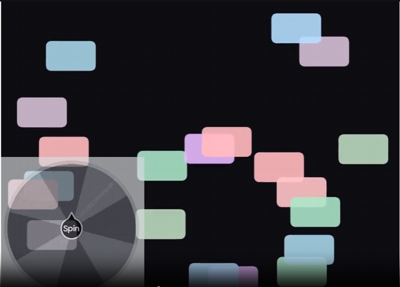

## Challenge description

The challenge provides a .mp4 file along with the description:

```
I wanna steal everything, but I don't know where it is.... maybe this video can help?
```

Artifacts:
- [finderskeepers.mp4](https://github.com/ssung099/CTF-Writeups/blob/main/csaw-2026/crypto/Finders-Keepers/finderskeepers.mp4)

## Solve explanation
Watching the video, I noticed that there was some text in spin wheel around 3 seconds into the video.


The text says `Y2FudGZpbmRpdA==` which looks like a base64 encoded string. Using CyberChef to decode this value, we get back the string `cantfindit`. This definitely seems to be an important value to the challenge, most likely a key.

Watching the rest of the video, there doesn't seem to be anything else that we can directly find.

Next, I took a look at the file metadata to see if there was anything else.

The `subject` field was set to a value `ZXNucHtkMGNfQHl6QGdsX21uMGpfcG0zejNfZzBfbzAwc30=` that again seems to be some base64 value. Decoding this value, we get the string `esnp{d0c_@yz@gl_mn0j_pm3z3_g0_o00s}`, which is very similar to the expected flag format `csaw{...}`.

Taking the value `cantfindit` that we got earlier, I tried decrypting the text using vigenere cipher against only the alphabet values. The string decrypts to `csaw{y0u_@lw@ys_kn0w_wh3r3_t0_l00k}`, getting us the flag and solving the challenge.